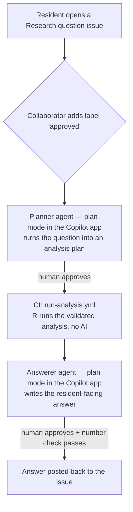

# Air-quality analysis via GitHub issues

> [!CAUTION]
> **Experimental hackathon project — do not use for real purposes.**
>
> This repository is **highly experimental**. It was created during a hackathon
> for demonstration purposes only. Everything here is vibe-coded, and the
> code's validation and review were also done with AI. While the answers to the
> questions may look trustworthy, **the authors made no effort to validate the
> answers**. **No one should use this code, or rely on its output, for any
> real-life purpose.**

## Introduction

This repository is a submission for the **Hackathon Hollandse Luchten**
(November 13th, 2026), an event organised to collaborate on cleaner air and
real societal impact using low-cost air-quality sensor data collected by
residents across North Holland.

Specifically, it is the result of participating in
[**Challenge 3: Help residents analyse data more easily**](https://github.com/provincieNH/HackathonHollandseLuchten/tree/main/challenge%203).
That challenge asks for an intelligent assistant that lets residents explore,
analyse and interpret their own sensor data without needing to be data
analysts. Residents ask a question in natural language; the system interprets
it, runs the analysis using the validated
[Samen Analyseren / Analyse-Together](https://github.com/rivm-syso/Analyse-Together)
functions, and returns an answer with its interpretation, uncertainties and a
complete audit trail of the data, choices and methods used.

Our take on this challenge turns every resident question into a GitHub issue
that doubles as a transparent, public audit trail of the analysis.

## Goal

The goal of this project is to create a reusable **skill**
([`.github/skills/air-quality-analyst/SKILL.md`](.github/skills/air-quality-analyst/SKILL.md))
and its associated files — reference material, schemas and helper scripts — that
anyone can drop into their own AI agent or application. The skill encodes how a
domain expert approaches air-quality data: which validated functions to use,
how to check sensor quality, how to express uncertainty, and how to explain
results in plain language.

With this skill, a layman user is assisted in making sense of large and complex
datasets and can answer their own questions about local air quality, without
needing to be a data analyst. It does **not** replace the knowledge of the
experts. Instead, it helps the user reach a first, transparent interpretation of
the data and gives them a well-documented starting point to discuss the meaning
and interpretation of that data with an expert.

The GitHub-issue workflow in this repository is one concrete demonstration of
the skill in action, but the skill itself is the reusable deliverable.

## How it works

Every resident question lives on **one GitHub issue**, which doubles as the
public audit trail. A single human approval starts the pipeline, and each stage
posts its result as a comment on that same issue. Progress is tracked with
labels, so the flow is resumable and every transition is visible.

The work is split into three stages. The two stages that use a Copilot agent
run **inside the Copilot app in plan mode**, so a human reviews exactly what the
agent will post before it touches the issue. The deterministic analysis runs
unattended in GitHub Actions. See
[`docs/automated-workflow.md`](docs/automated-workflow.md) for the full design
and the reasoning behind this split.



1. **Ask.** A resident opens a *Research question* issue with their question in
   plain language.
2. **Approve.** A maintainer or collaborator adds the `approved` label — the
   single gate that starts the run (only triage/write users can add labels).
3. **Plan.** The `analysis-request-planner` agent interprets the question,
   chooses sensors, period and validated functions, and — after a human
   approves in the app — posts the plan as a comment and adds `plan-ready`.
4. **Analyse.** `run-analysis.yml` runs `scripts/run_analysis.R` over the
   committed sensor data, posts `03_results.json` and the audit log, and adds
   `results-ready`. No AI is involved: every number comes from the validated R
   functions.
5. **Answer.** The `analysis-answerer` agent explains the result in accessible
   language, runs the automated number check (`scripts/check_run.py`, which
   confirms every number traces back to `03_results.json`), and — after a human
   approves — posts the answer and adds `answer-ready`.

Any stage that fails adds `needs-attention` and a short comment so a human can
step in.

## Repository layout

| Path | What it is |
| --- | --- |
| [`.github/skills/air-quality-analyst/`](.github/skills/air-quality-analyst/) | **The core deliverable: the reusable skill.** Contains `SKILL.md` (the workflow and hard rules), `references/` (domain knowledge: functions, question recipes, sensors and sensor-quality rules) and `assets/` (the answer template, an example run and the JSON `schemas/` for every hand-off). |
| [`.github/agents/`](.github/agents/) | The two Copilot agents that drive the issue workflow: `analysis-request-planner.md` (turns a question into a plan) and `analysis-answerer.md` (writes the resident-facing answer). |
| [`.github/workflows/`](.github/workflows/) | GitHub Actions. `run-analysis.yml` runs the deterministic R analysis when an issue is labelled `plan-ready`. |
| [`.github/ISSUE_TEMPLATE/`](.github/ISSUE_TEMPLATE/) | The *Research question* issue template residents fill in. |
| `.github/copilot-instructions.md` | Repository-wide instructions for Copilot. |
| [`scripts/`](scripts/) | Helper scripts: `run_analysis.R` (the R analysis entry point), `check_run.py` (the number check / schema validation) and `postcode_to_latlon.py` (resolves a postcode to coordinates). |
| [`docs/`](docs/) | Design documentation: [`automated-workflow.md`](docs/automated-workflow.md) (the human-in-the-loop workflow), [`run-lifecycle.md`](docs/run-lifecycle.md) (the files and hand-offs of a run), [`skill-overview.md`](docs/skill-overview.md) (the skill's structure), [`tool-status.md`](docs/tool-status.md) (which analysis tools are implemented) and [`limitations.md`](docs/limitations.md) (known limitations and validation status). |
| [`examples/`](examples/) | A worked example: a sample issue body, a plan and a complete checked run folder (`P-2026-11-13-0001`). |
| [`data/`](data/) | The committed datasets. See the [Data](#data) section below for a full description. |

## Data

This repository contains **large datasets in `data/`** (~130 MB in total). Data
like this normally does not belong in a Git repository, but it is committed here
for convenience, so that a run can read it directly without anyone having to
download or register for anything first. The data originates from the
[Hackathon Hollandse Luchten](https://github.com/provincieNH/HackathonHollandseLuchten)
materials and the [Zenodo record 23762846](https://zenodo.org/records/23762846).
All of it is open data.

| Dataset | File(s) | What it contains |
| --- | --- | --- |
| **Citizen sensor measurements** | `data_sensors.parquet` (~81 MB) | ~5.7 M hourly measurements from ~520 low-cost Hollandse Luchten sensor kits (2020–2025): raw PM2.5/PM10, calibrated PM2.5, temperature, relative humidity, pressure, and the kit's location. These are the measurements the analysis actually works on. |
| **Sensor hardware metadata** | `metadata_sensors.parquet` (~8 KB) | One row per sensor kit (569 kits) describing which hardware produced each signal (e.g. Sensirion SPS30 for PM, DHT22 for temperature/humidity). Used for the sensor-quality checks. |
| **Official reference measurements** | `reference_measurements.parquet` (~39 MB) | ~7.5 M hourly PM10 and PM2.5 values from official Luchtmeetnet stations (2020 – Sept 2026), in µg/m³. Used to compare citizen sensors against calibrated reference stations. |
| **Reference station metadata** | `reference_station_metadata.csv` | 96 official stations with name, place, coordinates, height, area type (e.g. urban/regional) and station type (e.g. traffic/background). |
| **KNMI weather** | `knmi_weather_data.parquet` (~12 MB) | ~3.7 M hourly weather records from 70 KNMI stations (2020 – Oct 2026): wind direction, wind speed, temperature and relative humidity. Used for context such as pollution roses. |
| **Resident questions** | `resident_questions.csv` | 74 real (Dutch) questions residents asked about their air quality, with location, date, title and description — the kind of question this project aims to answer. |
| **Labeled data** | `labeled_data/<date>/*.csv` | Residents' survey answers and their assessments of algorithmically flagged measurements from two collection rounds. These are participants' judgments, not ground-truth labels. |

> [!NOTE]
> Only `data_sensors.parquet` and `metadata_sensors.parquet` are strictly
> required to run an analysis; the other datasets are included for context,
> validation and future extensions.

Because the data is committed, the sensor tables are explicitly un-ignored in
`.gitignore` while everything else under `data/` stays ignored by default.

## Output files (one set per run)

Every question is processed as one **run** — a small set of files (`01_request`
… `05_check`, `audit.jsonl` and the rendered `answer.md`), each written by one
step and read by the next, so the whole analysis is reproducible and every
number is traceable. A run folder is created on demand (locally, or as the CI
`out/` artifact) and is **not** committed; the only committed run is the worked
example in [`examples/P-2026-11-13-0001/`](examples/P-2026-11-13-0001).

See [`docs/run-lifecycle.md`](docs/run-lifecycle.md) for the full description of
each file, what every step reads and writes, and the rules the files obey.

## Run locally

```bash
pip install jsonschema
python scripts/check_run.py examples/P-2026-11-13-0001
```

This validates every file in a run folder against its schema, runs the number
check, writes `05_check.json`, and writes `answer.md` (the answer as the resident
sees it). Exit code 0 = pass. `examples/P-2026-11-13-0001/` is a checked-in
example run (the Beverwijk prototype, Dec 2024 vs Jan 2025); its numbers come
from an early stand-in rather than a full production run.

To produce `03_results.json` with R (into an output folder of your choice):

```bash
Rscript scripts/run_analysis.R <plan>.json <out_dir>
```

The analysis in `run_analysis.R` is largely implemented (sensor selection by
distance, sensor-quality checks, outlier filtering, regional background and
daily averages); some optional tools (neighbour comparison, time-series and
wind-direction plots, pollution rose) are not yet implemented. See
[`docs/tool-status.md`](docs/tool-status.md) for the full status.

The plan selects sensors by distance, so `area` needs a centre (`lat`/`lon`),
not just a postcode. Resolve a resident's postcode to coordinates with
`python scripts/postcode_to_latlon.py "1941"` (uses the free PDOK Locatieserver).

## Deploy it yourself

To run this workflow in your own repository you need:

1. A GitHub repository with Actions enabled and a GitHub Copilot licence.
2. The contents of this repository in the root (the skill lives in
   `.github/skills/air-quality-analyst/`, where Copilot looks for skills).
3. Python 3 with `pip install jsonschema` for the number check, and R with
   `jsonlite`, `nanoparquet`, `dplyr` and `lubridate` for the analysis.

The sensor data is already committed under `data/` (see [Data](#data)), so no
download is needed.

Set-up steps:

1. In repository Settings › Actions › General, set workflow permissions to
   "Read and write" so the workflow can post comments and manage labels.
2. Create the labels `research-question`, `approved`, `app-working`,
   `plan-ready`, `results-ready`, `answer-ready` and `needs-attention`.
3. Set up the **app orchestrator**: a scheduled session in the Copilot app that
   polls for `approved` and `results-ready` issues, claims them with
   `app-working`, and starts the planner / answerer agents in plan mode. It lives
   **outside this repository** (it is Copilot app state, not a committed
   workflow). See [`docs/automated-workflow.md`](docs/automated-workflow.md)
   (section 5) for how it is configured.
4. Connect any remaining tools in `scripts/run_analysis.R` to the real Samen
   Analyseren or openair functions where they still report `not_available`.

## Try it

Open a new **Research question** issue with your question, then add the
`approved` label. The orchestrator plans it (with your approval in the app), the
analysis runs, and the answer is posted back. To exercise just the analysis
workflow, add a comment holding a `### Analysis plan (JSON)` block (see
`examples/beverwijk-issue-body.md` or `examples/beverwijk-plan.json`) and add the
`plan-ready` label, or dispatch it manually:
`gh workflow run run-analysis.yml -f issue_number=<N>`.

## Safety

- Nothing runs until someone with triage rights adds `approved`, and each
  Copilot stage pauses in the app for a human to approve before it posts.
- The issue text is never passed through the shell; the plan is read in a
  script and validated against the schema.
- `run_analysis.R` refuses any tool that is not on its allowed list.

## License

This project is licensed under the **GNU General Public License v3.0** — see
[`LICENSE`](LICENSE). This is consistent with the
[Analyse-Together / Samen Analyseren](https://github.com/rivm-syso/Analyse-Together)
functions (GPL-3) that the analysis builds on. The analysis also uses the
[`openair`](https://davidcarslaw.github.io/openair/) R package (GPL-2/GPL-3). The
datasets in `data/` are open data (see the [Data](#data) section for sources).
