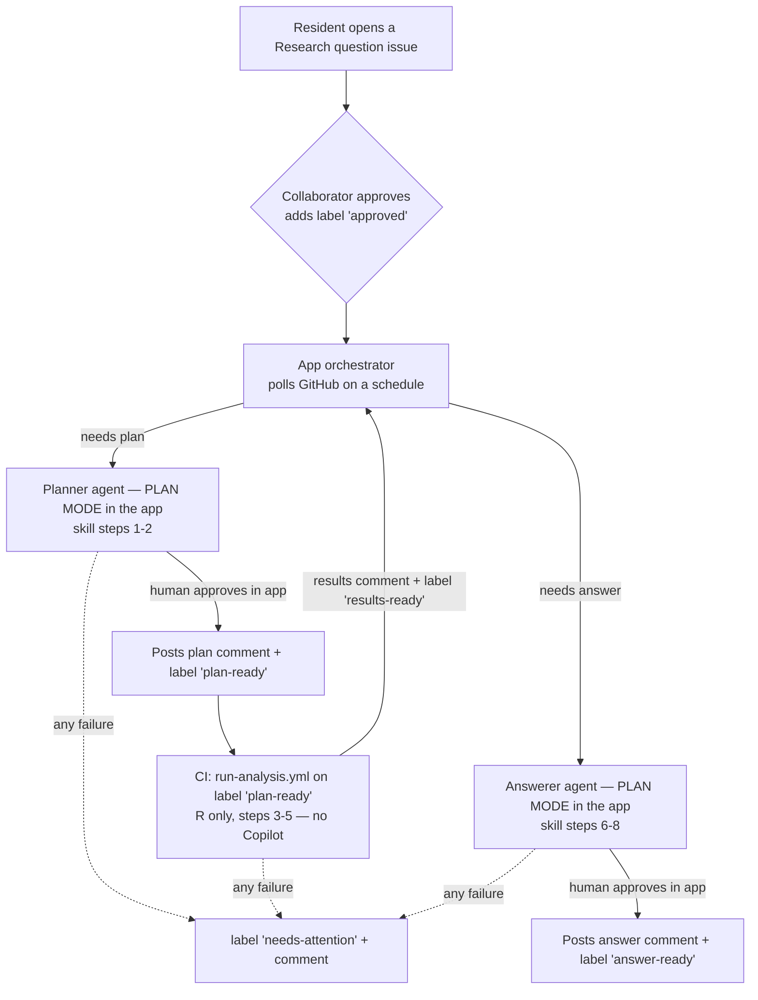

# Automated issue workflow (with human oversight)

This document explains how a resident's air-quality question is turned into a
checked, resident-facing answer with as little manual work as possible, while
keeping a human in the loop on the steps we do not yet trust unattended.

It covers:

1. The design (one issue, one approval, a label-driven state machine).
2. Where each stage runs and why.
3. The risks of running the Copilot agents non-interactively.
4. The decision: **we do not run Copilot in CI yet** — the Copilot stages run
   inside the Copilot app with a human checkpoint.
5. How oversight works and how to move to full automation later.

## 1. Design

Everything happens on **one GitHub issue**: the resident's *Research question*.
A single approval by a maintainer or collaborator starts the whole pipeline, and
each stage posts its result as a comment on that same issue. State is tracked by
labels, so the flow is resumable and every transition is visible.

### Labels (the state machine)

| Label | Meaning | Added by |
| --- | --- | --- |
| `research-question` | A new resident question | Issue template |
| `approved` | A collaborator authorised the whole run (the single gate) | Maintainer/collaborator |
| `app-working` | A stage is in flight for this issue (idempotency claim) | Orchestrator |
| `plan-ready` | The plan is posted as a comment; start the analysis | Planner agent |
| `results-ready` | R has posted `03_results.json`; write the answer | `run-analysis.yml` |
| `answer-ready` | A number-checked answer is posted | Answerer agent |
| `needs-attention` | A stage failed; a human should look | Any stage on error |

Only users with triage/write permission can add labels, so `approved` is an
inherently permission-gated approval signal.

### One comment per stage

- **Plan** (skill steps 1–2): the planner posts a plain-words plan plus the plan
  JSON in a `### Analysis plan (JSON)` fenced block.
- **Analysis** (skill steps 3–5): `run-analysis.yml` posts a per-step status
  table (data check, sensor check, background, analysis) followed by
  `03_results.json` and the audit log.
- **Answer** (skill steps 6–8): the answerer posts `answer.md`, the
  resident-facing answer, only after the automated number check passes.

## 2. Where each stage runs

| Stage | Steps | Runs in | Needs Copilot? |
| --- | --- | --- | --- |
| Plan | 1–2 | **Copilot app** (plan-mode session) | Yes |
| Analysis | 3–5 | **GitHub Actions** (`run-analysis.yml`, R) | No |
| Number check | 7 | GitHub Actions / local (`check_run.py`) | No |
| Answer | 6, 8 | **Copilot app** (plan-mode session) | Yes |

The analysis is deterministic R over committed data and is safe to run
unattended in CI. The two stages that use a Copilot agent run in the app.

## 3. Risks of running the Copilot agents non-interactively

Running the planner and answerer headlessly in CI (no human watching) carries
risks that we cannot yet measure or bound:

- **Prompt injection.** The issue and comments are attacker-controllable and are
  fed to an agent that has `gh` and shell access.
- **Hard-rule violations.** An agent might invent a number, drop the uncertainty
  section, claim cause and effect, or give health advice — with no one to catch
  it before it is posted to a public, resident-facing issue.
- **Non-determinism.** The same question can produce different plans or answers;
  quality varies run to run.
- **Silent failure / false success.** An agent may report success while the real
  artifact was not produced or did not pass the number check.
- **Secrets in CI.** A Copilot credential must live in Actions; it can be
  over-scoped, leak in logs, or be abused via injection.
- **Hangs.** The agents are written to ask a clarifying question when input is
  missing; headless there is no one to answer, so a run can stall.
- **Cost and loops.** Label-driven retries can re-fire and consume quota.

Mitigations exist for all of these (least-privilege tokens, schema validation,
the number check as a blocking gate, timeouts, idempotency guards), but we have
**not yet observed enough real runs to trust them unattended.**

## 4. Decision: keep the Copilot stages in the app for now

**We do not run the Copilot agents in CI yet, because we cannot oversee the
risks above well enough.** Instead:

- The deterministic **R analysis stays in CI** (no Copilot, low risk).
- The **planner and answerer run inside the Copilot app**, started
  automatically by a scheduled orchestrator, but in **plan mode** so each one
  pauses and shows exactly what it will post *before* it touches the issue. A
  human approves (or edits, or stops) in the app.

This keeps the flow automatic end-to-end — one approval starts it, stages chain
themselves — while putting a human checkpoint on precisely the two steps we do
not yet trust unattended.

## 5. Oversight and the path to full automation

The orchestrator is a scheduled session in the app that, on each tick:

1. Finds issues labeled `approved` that still need a plan, and issues labeled
   `results-ready` that still need an answer.
2. Claims each with the `app-working` label (so overlapping ticks do not double
   dispatch).
3. Spawns the matching agent (`analysis-request-planner` /
   `analysis-answerer`) as a **plan-mode** child session and notifies you.

You review the child in the app, approve it, and it posts the comment and sets
the next label. The number check (`scripts/check_run.py`) remains a blocking
step inside the answerer, so an answer that does not trace every number back to
`03_results.json` can never be approved.

**Progressive trust.** Start every stage in plan mode. After enough real runs
give you confidence, relax a stage to `interactive`, then `autopilot`, and only
then consider moving it into CI. The CI R stage and the label contract stay
identical throughout, so no rework is needed.
