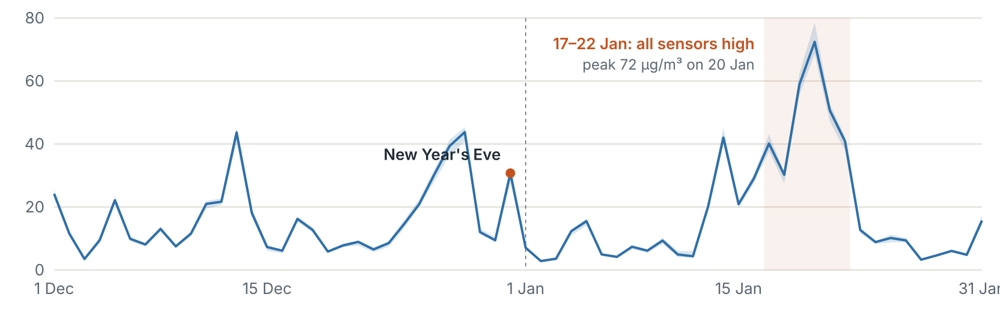

**On a normal day, the air in January was cleaner than in December: 9.4 versus 12.0 micrograms of fine dust per cubic metre.**

### What this means
But from 17 to 22 January the air was much worse, up to 72.4 on 20 January. That week almost all sensors were high at the same time, which usually points to pollution over the whole region rather than a source nearby. Because of that week, January had more days above 25 than December: 8 versus 5.

### How sure are we?
We used 39 of the 54 sensors: 5 were left out because they were broken, and others had too little data. On 25.5% of the hours the air was very damp, and these sensors then tend to read too high. We have not yet compared with an official measuring station.

### How we got this
- Sensors within 2 km of central Beverwijk, December 2024 and January 2025, calibrated PM2.5
- Broken sensors and impossible values removed first
- Daily value per sensor (at least 18 hours of data), then the typical day for the area
- Run: P-2026-11-13-0001

**You could also ask:**
- Compare with the nearest official measuring station
- Was the week of 17 to 22 January also high elsewhere in the region?
